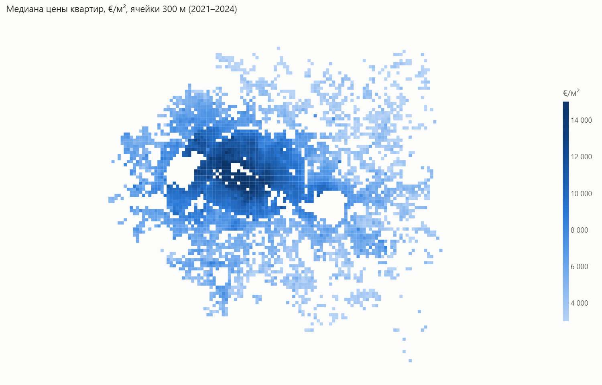
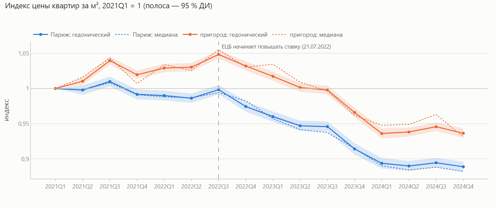
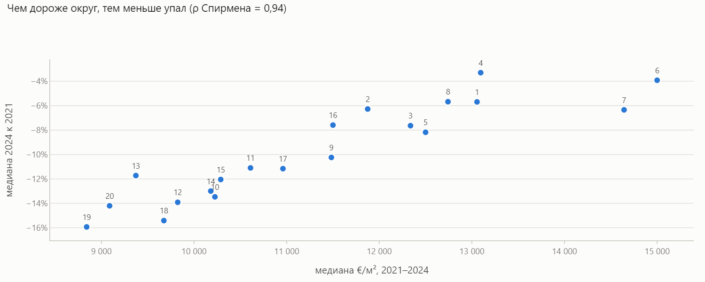
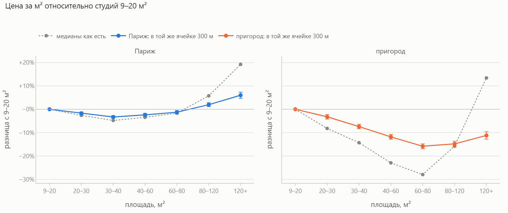
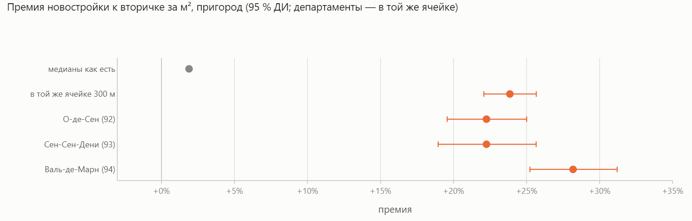
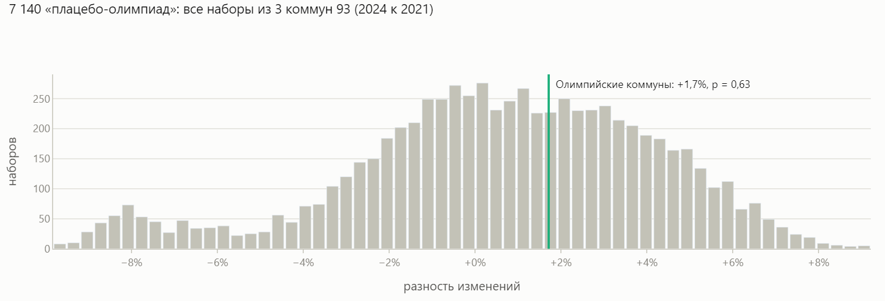
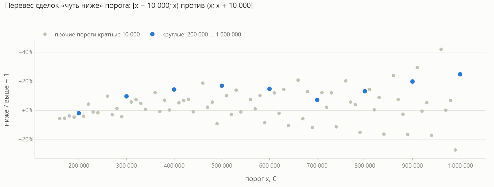

# Рынок жилья Парижа: 317 тыс. сделок, 2021–2024 — EDA

Разведочный анализ всех нотариальных продаж жилья в Париже и ближнем пригороде
(департаменты 92, 93, 94) из открытого французского реестра **DVF**.

👉 **[Интерактивный отчёт](https://alex91132.github.io/paris-dvf-eda/)**: карты, индексы, все графики с подсказками.
📘 **[Как делать EDA: пошаговое руководство с командами](docs/EDA_GUIDE.md)** — методика этого проекта как инструкция для своего.

Анализ построен на **гипотезах**, а не на «посмотрим на распределения». Каждый раздел заканчивается
статистической проверкой: регрессия с фиксированным эффектом локации, кластерные ошибки, бутстреп,
перестановочный тест. Три из восьми проверок дали результат, противоположный наивному.



## Данные

[Demandes de valeurs foncières géolocalisées](https://files.data.gouv.fr/geo-dvf/): DGFiP, геокодирование
Etalab, [Licence Ouverte 2.0](https://www.etalab.gouv.fr/licence-ouverte-open-licence/). Взято 2021–2024
по департаментам 75, 92, 93, 94: 1 043 342 строки и 448 106 сделок. В репозиторий данные не входят,
`scripts/download.py` скачивает их (~23 МБ).

Главная ловушка — что считать строкой. В DVF строка — это *сделка × участок × помещение × вид угодий*,
и полная цена сделки повторяется в каждой строке. Квартира с парковкой и погребом занимает три строки
с одной и той же ценой. В очистке остаются сделки ровно с одним жильём, без коммерческих помещений и с одной
ценой. После границ правдоподобия и робастного фильтра выбросов внутри коммуны получилось **317 024 продажи**,
из них 277 504 квартиры.

## Ключевые результаты

- **Локация решает почти всё.** Ячейка 300 × 300 м объясняет **81 %** разброса log(€/м²). Площадь,
  комнаты и время добавляют к ней 1,4 п.п. Поэтому все сравнения ниже сделаны *внутри* ячейки.
  Сравнивали и Париж с пригородом на одном расстоянии от центра (4–7 км): с поправкой на расстояние
  Париж дороже на **+44 %** (95 % ДИ [+30; +60]). Административная граница стоит дороже километров.
- **После подъёма ставок цены упали.** Это показывает гедонический индекс, то есть цена той же квартиры
  в том же месте. Париж к концу 2024 потерял **−12,0 %** от пика 2021Q3 (95 % ДИ индекса 0,881–0,896).
  Пригород рос до 2022Q3 и с тех пор потерял **−10,7 %**. Проверили и состав сделок: наивная медиана
  почти совпала с индексом.
- **Объём падает сильнее цены.** Число сделок в 2024 году относительно 2021-го: Париж −20 %, пригород −38 %
  (новостройки −63 %). Цены «липкие». По 130 коммунам (в каждой ≥60 сделок и в 2021–22, и в 2023–24;
  всего в данных 142 коммуны): где цена падала меньше, сильнее падал объём (ρ = −0,25, p = 0,004).
- **«Бегство в качество».** Чем дороже округ Парижа, тем меньше он потерял: ρ = 0,94
  (95 % ДИ 0,80–0,98 — бутстреп по 20 округам).
  6-й округ потерял −4 %, 19-й −16 %. Пригород относительно Парижа подорожал на +6 % («эффект пончика»),
  в основном до ставок.
- **Парадокс Симпсона в размере квартиры.** В пригороде медианы показывают, что квартиры от 120 м²
  на +13 % дороже студий за м². В той же ячейке они на −11 % *дешевле*: большие квартиры просто
  стоят в дорогих коммунах. В Париже «студии дороже за метр» почти не работает: разница ±6 %.
- **Премия новостройки занижена в 13 раз.** Медианы дают +1,9 %, а в той же ячейке **+23,9 %**
  [+22,1; +25,7]. Новые дома строят там, где дешевле земля.
- **Олимпиада — эффект не найден.** Олимпийская деревня стоит в Сен-Дени, Сент-Уане и Иль-Сен-Дени.
  Разность разностей с остальными коммунами 93 даёт +1,7 %, перестановочный p = 0,63 по 7 140
  плацебо-наборам. Игры объявлены в 2017-м — ожидания, вероятно, были в цене раньше 2021 года.
- **Психология цены.** 69 % цен кратны 1 000 €. У круглых порогов (кратных 100 000) сделок «на 10 000 ниже»
  на +12,8 % больше, чем «на 10 000 выше». У прочих порогов перевес всего +2,2 % (Манн — Уитни, p = 0,002).
  Значит, перевес «чуть ниже» у круглых чисел — не артефакт формы распределения.
- **Сезонность.** Сделок в день в июле 1,34 от среднего, в августе 0,66. Цена июльских и августовских
  сделок на +1,7 % выше тренда, F = 12,1, p < 0,001.

| | |
|---|---|
|  |  |
|  |  |
|  |  |

## Чему учит этот EDA

1. **Сначала понять, что такое строка.** Без агрегации до сделки «цена за м²» по DVF — мусор.
2. **Сравнивать внутри локации.** Без фиксированного эффекта ячейки премия новостроек занижена в 13 раз,
   а у больших квартир в пригороде меняется знак.
3. **Проверять состав, даже если он не помешал.** Совпадение наивной медианы с гедоническим индексом — это
   результат проверки, а не допущение.
4. **Тренд — не сезонность.** При падающем рынке дамми месяцев с годовыми эффектами показывают «дешёвый
   декабрь» на −2 %. Разложение относительно скользящего среднего 2×12 оставляет от него −0,6 %.
5. **Мало «экспериментальных» единиц — значит, перестановки.** Три олимпийские коммуны — не основание
   для асимптотических кластерных ошибок.
6. **Нулевой результат — тоже результат.** Олимпийского эффекта нет, а пончик скромный.

## Как воспроизвести

```bash
python -m venv .venv && .venv/Scripts/pip install -r requirements.txt   # Linux/macOS: .venv/bin/pip
python scripts/download.py        # данные DVF → data/raw/
python scripts/report.py          # docs/index.html + docs/report.json
python make_notebook.py           # paris_dvf_eda.ipynb (исполненный)
python scripts/readme_images.py   # docs/img/*.png
pytest
```

Все числа в отчёте и ноутбуке считаются из данных при сборке. Сводка ключевых чисел лежит в `docs/report.json`.

## Структура

```
├── src/dvf/
│   ├── clean.py      # сырой DVF → одна строка на продажу жилья (+ воронка очистки)
│   ├── stats.py      # FE-регрессия с кластерными ошибками, бутстреп, перестановочный DiD, пороги
│   ├── analysis.py   # гипотезы: индекс, объёмы, пончик, размер, новостройки, Олимпиада, круглые цены, сезон
│   └── figures.py    # графики Plotly (одна палитра на весь отчёт)
├── scripts/          # download.py, report.py (→ docs/index.html), readme_images.py
├── analysis.py       # ноутбук в формате ячеек «# %%»
├── make_notebook.py  # analysis.py → paris_dvf_eda.ipynb
├── paris_dvf_eda.ipynb
├── docs/             # интерактивный отчёт (GitHub Pages), EDA_GUIDE.md, report.json, картинки
└── tests/            # очистка, статистика (сверка с statsmodels), выводы на реальных данных
```

Фиксированный эффект ячейки (5 122 ячейки) реализован через внутригрупповое преобразование. Через
дамми statsmodels требует ~10 ГБ памяти, так — секунды. Коэффициенты совпадают с регрессией на дамми
до 1e-10 (см. `tests/test_stats.py`).

## Ограничения

- Площадь в DVF кадастровая (surface_reelle_bati), а не Каррез. Этажа, состояния, вида из окна и года
  постройки в DVF нет: они уходят в остаток модели, и ячейка 300 м поглощает их лишь частично.
- Повторных продаж нет: у квартиры нет сквозного идентификатора, поэтому индекс гедонический, а не repeat-sales.
- Дата сделки — это подписание у нотариуса. Цену договариваются на 2–4 месяца раньше, поэтому все сдвиги
  во времени запаздывают примерно на квартал.

Данные: DGFiP, Demandes de valeurs foncières; геокодирование — Etalab; Licence Ouverte 2.0.
